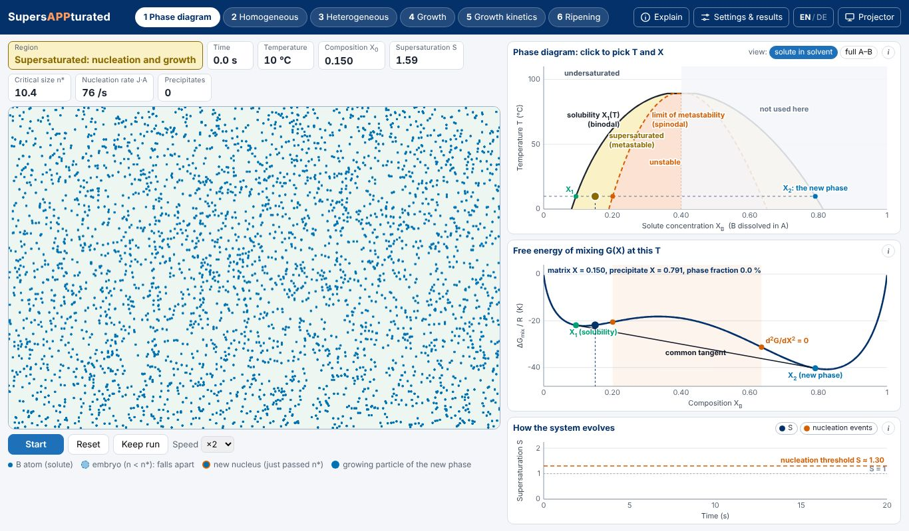

# SupersAPPturated — nucleation and growth

SupersAPPturated is a browser app for teaching how a new phase forms from a supersaturated solution. Students pick a point in the phase diagram and watch homogeneous and heterogeneous nucleation, growth, growth kinetics on a lattice and Ostwald ripening, with the free-energy curve and supersaturation plotted alongside. It runs in English and German (`#EN` / `#DE`).

| Branch | Address |
| --- | --- |
| `main` | https://supers-app-turated.ipt-apps.workers.dev/ |
| `dev` | https://dev-supers-app-turated.ipt-apps.workers.dev/ |



## Build and check

Use Node.js 22 or later. No dependencies need installing.

```sh
npm test
npm run build
```

The app is the single file `src/index.html`. The build copies it unchanged to `build/deploy/`; open that file in a browser to test locally.

## Deployment

The repository is connected to Cloudflare Workers Builds with `main` as the production branch: build command `npm run build`, deploy command `npx wrangler deploy`, preview command `npx wrangler preview`. Make changes on `dev` and merge to `main` to release.

SupersAPPturated is distributed under the MIT License. It uses system fonts and contains no bundled font files.
